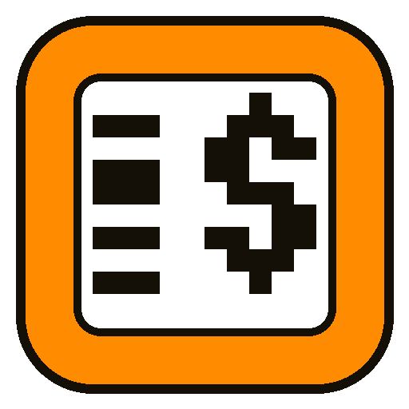
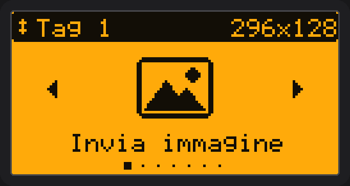
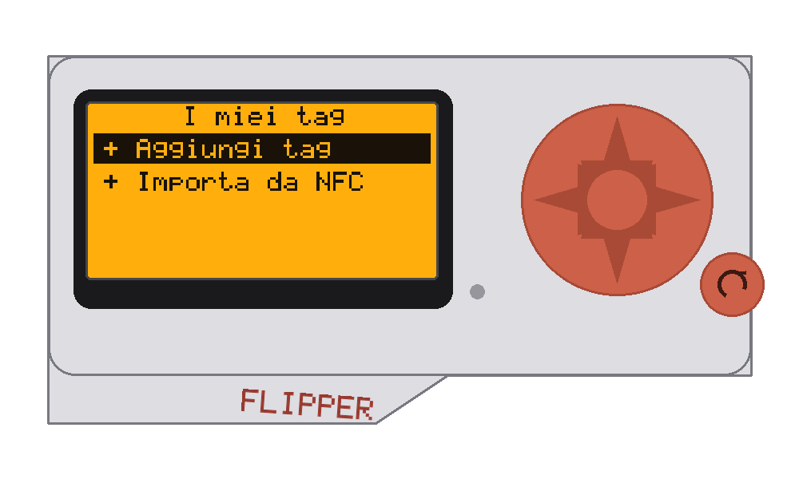
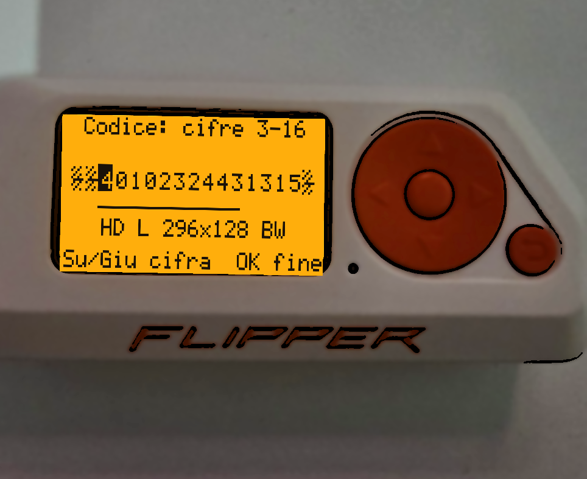
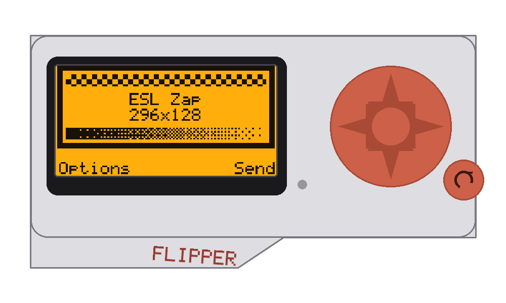
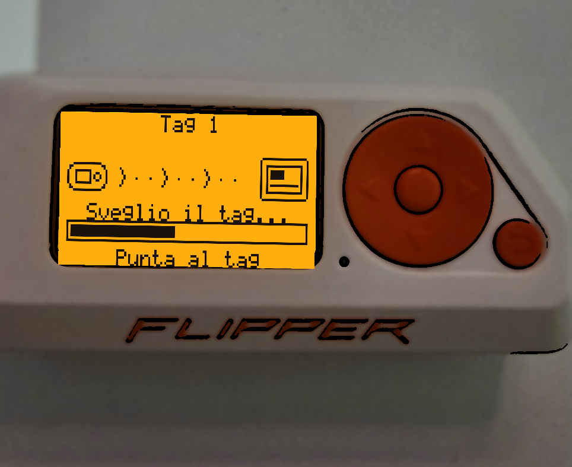
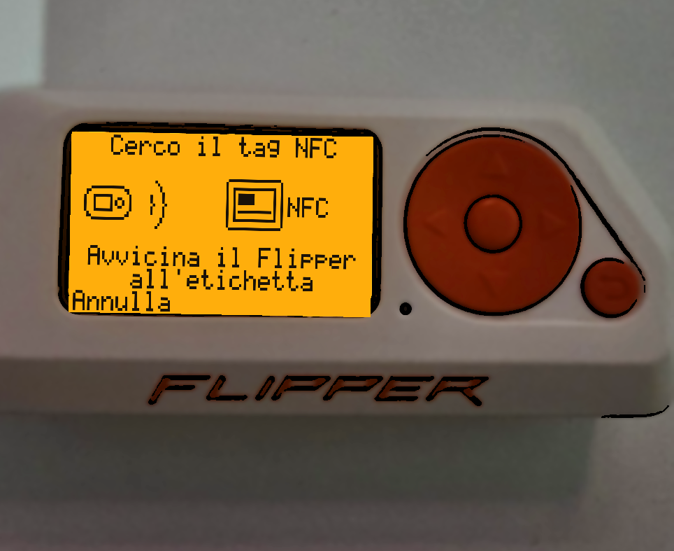

<table>
  <tr>
    <td valign="middle" width="78%">
      <h1>ESL Zap</h1>
      <b>Flipper Zero ESL price-tags zapper! · Infrared e-paper shelf labels · Immagini &amp; testo con un tocco</b>
    </td>
    <td valign="middle" align="right" width="22%">
      
    </td>
  </tr>
</table>

<p align="center">
  
  
  
  
  
</p>

<p align="center">
  <a href="#-what-it-is">What it is</a> |
  <a href="#-features">Features</a> |
  <a href="#-screenshots">Screenshots</a> |
  <a href="#-install">Install</a> |
  <a href="#-how-to-use">How to use</a> |
  <a href="#-supported-labels">Supported labels</a> |
  <a href="#-build-it-yourself">Build</a> |
  <a href="#-credits">Credits</a> |
  <a href="#-italiano">Italiano</a>
</p>

<h3 align="center">
  ⚡ <a href="https://sanguefreddo.github.io/ESL-Zap-Flipper-Zero/">Open the one-click installer &amp; photo editor</a> ⚡
</h3>
<p align="center"><sub>Connect your Flipper over USB, press Install. Or drop a photo and send it. Use Chrome, Edge or Opera on a computer.</sub></p>

---

# 🛡️ What it is

**ESL Zap** turns your **Flipper Zero** into a remote for **infrared electronic shelf labels (ESL)** you own — the e-paper price tags used on shop shelves. Point the Flipper at a label and send it a **picture**, some **text**, or a built-in **test card**. It drives the tag over infrared, exactly like the store's own base station, using the public protocol research by **furrtek**.

No PC needed to use it, no account, no cloud: everything runs on the Flipper and in a single offline web page for installing and preparing images.

> ⚠️ Use it only on labels **you own**. Changing displays in shops is not allowed. ESL Zap talks to **infrared** tags (Pricer family); radio tags (SES-imagotag / VUSION at 2.4 GHz) are **not** supported — the Flipper's hardware can't reach them.

# ✨ Features

| | |
| --- | --- |
| 📡 **Send images & text** | Any BMP (1/4/8/24/32-bit, any size) is scaled, dithered and sent. Also a text mode and a test card. |
| 🎨 **Red / yellow aware** | Detects the accent colour of tricolour tags and sends the colour plane automatically. |
| 🏷️ **Easy tag add** | Type only digits 3–16 of the barcode (the rest isn't needed), or **import from NFC** for tags that have a chip — the Flipper reads it live. |
| 🔌 **Works on every firmware** | One build each for **Official, Momentum and Unleashed**, rebuilt weekly by CI. RogueMaster shares Unleashed's API, so it uses the Unleashed build. |
| 🖱️ **One-click install** | A web page detects your firmware over USB and installs the right build; it also converts any photo for you. |
| 👀 **Preview first** | See exactly what the label will show, on the Flipper screen, before sending anything. |
| 🌍 **Bilingual** | Full interface in **Italiano** and **English**. |

# 📸 Screenshots

<table>
  <tr>
    <td align="center"><br><sub>Home — big icons, Up/Down switch tag</sub></td>
    <td align="center"><br><sub>My tags — add by barcode or from NFC</sub></td>
  </tr>
  <tr>
    <td align="center"><br><sub>Add tag — type digits 3–16, model shown live</sub></td>
    <td align="center"><br><sub>Preview — what the label will display</sub></td>
  </tr>
  <tr>
    <td align="center"><br><sub>Sending over infrared</sub></td>
    <td align="center"><br><sub>Import from NFC — live chip read</sub></td>
  </tr>
</table>

<sub>Real app screens on a Flipper Zero, cartoon style.</sub>

# 🚀 Install

### One click (recommended)

**[→ Open the installer ←](https://sanguefreddo.github.io/ESL-Zap-Flipper-Zero/)** in Chrome, Edge or Opera on a computer, connect the Flipper over USB (close qFlipper first) and press **Install**. It reads your firmware, copies the matching build to `SD/apps/Infrared/esl_zap.fap`, creates the images folder and starts the app.

### Manual

Download the `.fap` for your firmware from the [Releases](../../releases) page, copy it with qFlipper to `SD Card/apps/Infrared/`, and open it from **Apps → Infrared → ESL Zap**.

> Why one file per firmware? Every Flipper app is linked against a firmware API version, and the forks differ. ESL Zap only uses long-standing APIs, so every build keeps working, and the CI rebuilds them when firmware updates come out.

# 🎮 How to use

1. **Add your label** — *My tags → + Add a tag*: type digits **3 to 16** of the barcode (first two and the last are shown as `-` and aren't needed). The model and screen size appear while you type. Tags with an NFC chip can be added with **+ Import from NFC**.
2. **Choose what to send** — *Send image* (a BMP from `apps_data/esl_zap/images`), *Write text* (`_` = space, `|` = new line) or *Test card*.
3. **Check the preview**, tweak the options (fit, dithering, invert, colour, page).
4. **Aim and send** — hold the Flipper 5–30 cm from the label, IR window facing it, and press *Send*. The label redraws a few seconds later.

*Up/Down on the home screen switch the active tag. If a label doesn't react: Settings → Wake-up 15 s, Repeats 3×.*

# 🏷️ Supported labels

Infrared graphic labels whose 4-digit model code (barcode digits 13–16) is known, from 152×152 up to 800×480, mono / red / yellow. Unknown models can be added by setting the size by hand. Segment labels support page switching.

**Never remove a label's battery:** most models keep their address and image in volatile memory and stop working for good.

# 🔧 Build it yourself

```bash
pip install ufbt
ufbt update          # official SDK — or --index-url=<momentum|unleashed directory.json>
ufbt launch          # build, install and run on a connected Flipper
```

Host tests (protocol frames vs furrtek's PrecIR, and the NFC decoder): `sh tests/run_tests.sh /path/to/PrecIR`.
Self-contained installer page + end-to-end test: `python3 tools/make_site.py dist web site && node tests/web/e2e_install.js site dist`.

# 🙌 Credits

- Infrared ESL protocol reverse-engineered and published by **[furrtek](https://www.furrtek.org/?a=esl)** ([PrecIR](https://github.com/furrtek/PrecIR)). ESL Zap's frames are verified byte-for-byte against it.
- NFC id format documented by the **TagTinker** community (contribution by 7h30th3r0n3); the decoder is cross-checked against it.
- Inspired by **[TagTinker](https://github.com/i12bp8/TagTinker)**. ESL Zap is an independent implementation written from scratch.

# ⚖️ License

MIT — Copyright (c) 2026 **[SangueFreddo](https://github.com/SangueFreddo)**. See [LICENSE](LICENSE).
Flipper Zero is a trademark of Flipper Devices Inc.; this project is not affiliated with Flipper Devices or any label manufacturer.

---

# 🇮🇹 Italiano

**ESL Zap** trasforma il tuo **Flipper Zero** in un telecomando per le **etichette elettroniche a infrarossi (ESL)** di tua proprietà — i cartellini e-paper dei prezzi dei negozi. Punti il Flipper verso l'etichetta e le mandi un'**immagine**, del **testo** o l'**immagine di prova**. L'etichetta viene pilotata via infrarosso, esattamente come fa la base station del negozio, usando la ricerca pubblica sul protocollo di **furrtek**. Niente PC, niente account, niente cloud: tutto gira sul Flipper e in un'unica pagina web offline per installare e preparare le foto.

### ⚡ [Apri l'installer e l'editor foto](https://sanguefreddo.github.io/ESL-Zap-Flipper-Zero/)
Collega il Flipper via USB e premi Installa, oppure trascina una foto e inviala (Chrome, Edge o Opera).

### ✨ Caratteristiche
| | |
| --- | --- |
| 📡 **Invia immagini e testo** | Qualsiasi BMP (1/4/8/24/32 bit, ogni dimensione) viene scalato, dithering applicato e inviato. C'è anche la modalità testo e l'immagine di prova. |
| 🎨 **Riconosce rosso/giallo** | Rileva il colore d'accento dei tag tricolori e invia da solo il piano colore. |
| 🏷️ **Aggiunta facile** | Scrivi solo le cifre **3–16** del codice a barre (il resto non serve), oppure **importa da NFC** per i tag col chip: il Flipper lo legge in diretta. |
| 🔌 **Tutti i firmware** | Una build per **Official, Momentum e Unleashed**, ricompilata ogni settimana dalla CI. RogueMaster ha la stessa API di Unleashed, quindi usa la build Unleashed. |
| 🖱️ **Installazione 1 clic** | La pagina web riconosce il firmware via USB e installa la build giusta; converte anche le tue foto. |
| 👀 **Anteprima** | Vedi sullo schermo del Flipper cosa mostrerà l'etichetta prima di inviare. |

### 🎮 Come si usa
1. *I miei tag → + Aggiungi tag*: scrivi le cifre da **3 a 16** del codice a barre (le prime due e l'ultima appaiono come `-` e non servono). Il modello compare mentre scrivi. Per i tag col chip NFC: *+ Importa da NFC*, il Flipper lo legge in diretta.
2. Scegli *Invia immagine* (un BMP da `apps_data/esl_zap/images`), *Scrivi testo* (`_` = spazio, `|` = a capo) o *Immagine prova*.
3. Controlla l'anteprima e le opzioni (adatta, dithering, inverti, colore, pagina).
4. Tieni il Flipper a 5–30 cm dall'etichetta, finestra IR verso il tag, e premi *Invia*. L'etichetta si aggiorna dopo qualche secondo.

*Su/Giu nella home cambiano il tag attivo. Se un'etichetta non reagisce: Impostazioni → Risveglio 15 s, Ripetizioni 3×.*

### 🏷️ Etichette supportate
Tag grafici a infrarossi il cui codice modello (cifre 13–16 del codice a barre) è noto, da 152×152 fino a 800×480, mono / rosso / giallo. I modelli sconosciuti si aggiungono impostando la dimensione a mano. I tag a segmenti supportano il cambio pagina.

> ⚠️ Usalo **solo sulle tue etichette**. Funziona con i tag a **infrarossi** (famiglia Pricer); i tag **radio** SES-imagotag/VUSION a 2,4 GHz non sono supportati, perché l'hardware del Flipper non arriva a quella banda.

**Non togliere mai la batteria del tag:** quasi tutti i modelli tengono indirizzo e immagine in una memoria volatile e smettono di funzionare per sempre.

### 🙌 Crediti e licenza
Protocollo ESL a infrarossi decifrato e pubblicato da **[furrtek](https://www.furrtek.org/?a=esl)** ([PrecIR](https://github.com/furrtek/PrecIR)); i frame di ESL Zap sono verificati byte per byte con il suo. Formato dell'id NFC documentato dalla community **TagTinker** (contributo di 7h30th3r0n3). Ispirato a **[TagTinker](https://github.com/i12bp8/TagTinker)**; ESL Zap è un'implementazione indipendente scritta da zero.

Licenza **MIT** · © 2026 **[SangueFreddo](https://github.com/SangueFreddo)**. Flipper Zero è un marchio di Flipper Devices Inc.; questo progetto non è affiliato a Flipper Devices né ai produttori di etichette.
